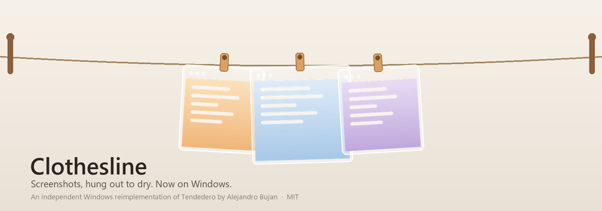

# Clothesline



**Windows 版「晾衣绳」：截图随手一挂，桌面干干净净。**

指针蹭一下屏幕最上沿，绳就滑下来，上面挂着刚拍的截图；指针离开，它自己收回去。

---

## 出处与致敬 · Credits

> **本项目改编自 [Tendedero](https://github.com/alejandrobujan/tendedero)** —— Alejandro Buján 为 macOS 写的一个小软件（Swift / AppKit / SwiftUI，MIT 许可）。
>
> Tendedero 只有 macOS 版。这里是一次**行为对齐的独立重写**：C# + WPF，**不含原作任何源代码**，但交互设计、交互手势、功能取舍乃至"晾衣绳"这个隐喻，全部来自原作——**这里每一个好点子都归功于原作者**。
>
> 原作以 MIT 授权其代码，但**名称与图标不在授权范围内**，因此本项目另取名为 Clothesline（英语"晾衣绳"），图标另行绘制，与原作者无从属关系，也不代表其背书。
>
> 若你在用 macOS，请直接去用原版，它更地道：[alejandrobujan/tendedero](https://github.com/alejandrobujan/tendedero)

原作的完整版权声明保留在 [LICENSE](LICENSE) 中。

## 它做什么

- 截图不再落在桌面。`Win + PrtScn` 拍下的每张图，都挂到屏幕顶部那条绳上。
- 绳平时藏着。指针触到屏幕最上沿，它滑下来；指针离开，收回去。
- 单击复制、双击打开、拖进微信/Word 直接用、拖进文件夹就归位、点 ✕ 丢进回收站。
- 全程本地运行：不联网、不上传、无账号、无统计。

## macOS 原版 → Windows 版映射

| Tendedero（macOS） | Clothesline（Windows） |
| --- | --- |
| 指针停在菜单栏，绳滑下 | 指针触屏幕最上沿，绳滑下（1.8 秒后自动收回） |
| `⌃⌥T` 显示 / 隐藏 | `Ctrl + Alt + T` |
| 单击 → 复制图片 | 单击 → 复制图片（浮现"已复制"） |
| 双击 → 预览打开 | 双击 → 用默认看图程序打开 |
| 长按 → 标记（Markup） | 暂未实现，双击后用系统"画图/照片"编辑 |
| 拖进应用 → 发送副本，仍挂在绳上 | 同左 |
| 拖进文件夹 → 文件归位，离开晾绳 | 同左（自动识别资源管理器） |
| 拖到废纸篓 / 点叉 → 丢弃 | 点 ✕ → 进回收站 |
| 复制来的图片也挂上（可选） | 托盘菜单「挂起复制的图像」（可选，默认关） |
| 全屏时自动隐身 | 同左 |
| 屏幕录制也挂在绳上，可裁剪 | 录屏以 ▶ 占位显示，可打开；裁剪暂未实现 |

## 安装

到 [Releases](../../releases/latest) 下载 `Clothesline.exe`，双击即可运行。

- 单文件、自包含（约 63 MB），**不需要安装 .NET**
- 无安装程序、不写系统目录、不注册服务；设置存于 `%APPDATA%\Clothesline\settings.json`

首次运行后，托盘会出现一枚"晾衣夹"图标：
- **左键**：放下 / 收起晾绳
- **右键**：菜单（放下晾绳、挂起复制的图像、开机自动启动、打开截图文件夹、退出）

## 从源码构建

需要 [.NET 8 SDK](https://dotnet.microsoft.com/download)。

```bash
git clone https://github.com/oldplusnew/Clothesline.git
cd Clothesline
dotnet build -c Release
dotnet publish Clothesline.csproj -c Release -r win-x64 --self-contained true \
  -p:PublishSingleFile=true -p:IncludeNativeLibrariesForSelfExtract=true \
  -p:EnableCompressionInSingleFile=true -o publish
```

> 注意：**必须自包含 + `IncludeNativeLibrariesForSelfExtract=true`**。框架依赖的单文件发布会因 WPF 原生库（`wpfgfx_cor3.dll`）探测失败而启动即崩。

图标由 `gen-icon.ps1`（GDI+ 绘制，输出多尺寸 ICO）生成；托盘图标在运行时代码绘制。

## 已知局限

- 只覆盖**主显示器**（多屏支持待办）
- 屏幕上沿若被"任务栏置顶"占用，会与触顶唤出冲突
- 录屏裁剪、长按标记、自定义快捷键：留待 0.2

## 代码结构

| 文件 | 职责 |
| --- | --- |
| `Program.cs` | 入口、单实例、异常日志 |
| `LineWindow.cs` | 顶部透明置顶面板：唤出/收起、挂图、剪贴板、热键 |
| `HangItem.cs` | 一张图：玻璃相框、晾衣夹、摆动/微风、拖拽与点击 |
| `ScreenshotWatcher.cs` | 监听 `图片\Screenshots`、`视频\Captures` |
| `MouseHook.cs` | 全局低级鼠标钩子（探测触顶） |
| `TrayIcon.cs` | 托盘图标（代码绘制 HICON）与右键菜单 |
| `Native.cs` | 全部 Win32 P/Invoke |
| `Settings.cs` | 设置持久化 |

## 许可

[MIT](LICENSE) —— 含 Tendedero 原作者 Alejandro Buján 的原始版权声明。名称与图标不在 MIT 范围内，见 LICENSE 末尾说明。

---

### In English

Clothesline is a Windows reimplementation of [Tendedero](https://github.com/alejandrobujan/tendedero) by Alejandro Buján — a tiny macOS app that hangs your screenshots on a line at the top of the screen. Original design, gestures and behaviour spec all belong to its author; this project is an independent C#/WPF rewrite with no code taken from it, under the same MIT license, with a different name and a separately drawn icon.
